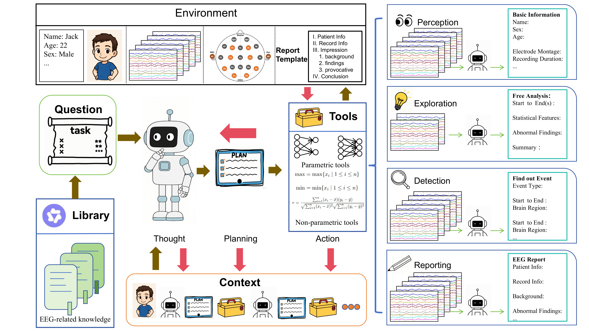

# EEGAgent Abstract
Scalable and generalizable analysis of brain activity is essential for advancing both clinical diagnostics and cognitive research. Electroencephalography (EEG), a non-invasive modality with high temporal resolution, has been widely used for brain states analysis. However, most existing EEG models are usually tailored for individual specific tasks, limiting their utility in realistic scenarios where EEG analysis often involves multi-task and continuous reasoning. In this work, we introduce EEG Agent, a general-purpose framework that leverages large language models (LLMs) to schedule and plan multiple tools to automatically complete EEG-related tasks. EEG Agent is capable of performing the key functions: EEG basic information perception, spatiotemporal EEG exploration, EEG event detection, interaction with users, and EEG report generation. To realize these capabilities, we design a toolbox composed of different tools for EEG preprocessing, feature extraction, event detection, etc. These capabilities were evaluated on public datasets, and our EEG Agent can support flexible and interpretable EEG analysis, highlighting its potential for real-world clinical applications.

# EEGAgent Framwork


# 使用方式

## 独立窗口（默认）

```bash
python main.py                                # 打开独立窗口：左侧数据概况/快捷提问，右侧问与答
python main.py --ui-demo                      # 只看窗口样式，不加载数据、不调用模型
python main.py --file test.edf --loader sleep # 指定数据文件和读取方式
python main.py --cli                          # 改用终端交互界面
python main.py --no-window --port 8777        # 只启动本地服务，自己用浏览器打开
python main.py -q "第 5 到第 10 分钟有没有慢波？"  # 单次问答，适合脚本/批处理
```

窗口里只显示**你的问题 + 最终结论**：模型推理、工具调用、耗时状态行都不出现（这些仍会写进 `runs/ui_sessions/` 的会话记录，便于事后复核）。左侧能看到当前文件、采样率、时长、导联、受试者、知识库，并可随时切换数据文件、读取方式（sleep / mdd / bipolar）和模型；顶部状态点表示"就绪 / 正在分析"。

实现方式：`ui/webapp.py` 用标准库起一个本地 HTTP 服务（无新增依赖），前端是 `ui/web/index.html`，通过 Chrome/Edge 的应用模式（`--app=`）打开成无地址栏的独立窗口。同一进程内复用同一个 `EEGAgent` 实例，不会每问一次都重新加载数据；首次启动顺带加载 RAG 向量模型，第一个问题不必再等。

## 终端界面

```bash
python main.py --cli                # 打开终端交互界面
python main.py --cli --show-tools   # 同时显示工具调用过程（排查问题用）
python main.py --ui-demo --cli      # 终端里的界面样式预览
```

终端界面从上到下分三块：**横幅 + 数据概况** → **对话区**（问题、可选工具卡片、Markdown 结论）→ **耗时指标**。每轮问答会自动写入 `runs/ui_sessions/` 下的 Markdown 记录。

API Key 的读取顺序：`--api-key` > 环境变量 `DASHSCOPE_API_KEY` > `config/secrets.json`。

### 界面内命令

| 命令 | 作用 |
| --- | --- |
| `/help` | 查看命令说明 |
| `/examples` | 查看示例问题，可直接照着提问 |
| `/info` | 重新查看当前数据概况 |
| `/file <路径或文件名>` | 切换脑电文件（相对 dataPath 或绝对路径） |
| `/loader <sleep\|mdd\|bipolar>` | 切换读取方式并重新加载当前文件 |
| `/clear` | 清空多轮对话上下文 |
| `/report` | 按报告模板生成一份完整 EEG 报告 |
| `/overview` | 快速概览这段数据 |
| `/model <名称>` | 切换模型 |
| `/save` | 立即保存会话记录 |
| `/exit` | 保存并退出 |

### 采样率校正

工具里所有"第几秒"的索引都依赖 `config['fs']`。启动时会用 EDF 文件头核对实际采样率，不一致时自动按文件校正，并在数据概况里标注，避免时间轴整体偏移。

# Project Structure
```
EEGAgent/
├─ main.py                 # Main project entry point
├─ prompt.py               # Prompt construction and management
├─ MDD_eval.py             # Evaluation pipeline for MDD task
├─ Sleep_eval.py           # Evaluation pipeline for sleep staging
├─ TUEV_eval.py            # Evaluation pipeline for TUSL task
├─ TUEV_oracle_run.py      # Evaluation tool-only performance on TUEV eval set
├─ README.md               # Project documentation
├─ __init__.py

├─ ui/                     # User interface
│  ├─ webapp.py            # Local HTTP service + app window launcher
│  ├─ web/index.html       # Single-page window UI (chat, data card, markdown)
│  ├─ info.py              # Shared data-profile fields for both UIs
│  ├─ theme.py             # Colors and console
│  ├─ render.py            # Banner, data card, messages, tool cards, metrics
│  ├─ session.py           # Terminal session / commands / status line
│  └─ transcript.py        # Markdown session log

├─ config/
│  ├─ config.json          # Global configuration and parameters
│  └─ secrets.json         # API Key（gitignored）

├─ data/                   # Raw EEG data files
│  ├─ *.edf / *.rec        # Raw EEG recordings
│  └─ edf/                 # Additional EDF files

├─ eval/                   # Training and evaluation modules
│  ├─ MDD/
│  │  ├─ train.py
│  │  ├─ predeal.py
│  │  ├─ README
│  │  ├─ checkpoints/
│  │  └─ data/, raw/
│  └─ sleep/
│     ├─ train.py
│     ├─ predeal.py
│     ├─ README
│     ├─ checkpoints/
│     └─ data/, sleep-cassette/

├─ RAG/                    # Retrieval-Augmented Generation module
│  ├─ chunker.py
│  ├─ embedder.py
│  ├─ indexer.py
│  ├─ searcher.py
│  ├─ txtDealer.py
│  ├─ chunks.pkl, faiss.index
│  ├─ docs/
│  └─ sentenceModel/
│     └─ bge-m3/

├─ runs/                   # runs log
│  ├─ tuev_agent
│  ├─ tuev_oracle_run

├─ tools/                  # EEG processing and feature extraction utilities
│  ├─ baseInfo.py
│  ├─ dataLoad.py
│  ├─ preprocessing.py
│  ├─ singleChannel.py
│  ├─ sleepStage.py
│  ├─ normalAbnormal.py
│  ├─ reflectData.py
│  ├─ healthMDD.py
│  ├─ polar.py
│  ├─ windowInfo.py
│  ├─ slowSeizBckg.py
│  ├─ register.py
│  ├─ registerData.py
│  ├─ localModels/
│  │  ├─ net.py
│  │  ├─ vote.py
│  │  ├─ *.pth
│  │  └─ __pycache__/
│  └─ __pycache__/

└─ utils/
   ├─ messageMerge.py
   ├─ parseCalling.py
   ├─ transFormat.py
   ├─ tuev_metrics.py
   └─ __pycache__/
```

# note
## Adding New Tools
Model-based tools
Add the .pth weight files under tools/localModels/, and create a corresponding Python file in /tools/ containing the tool description and model implementation.
You may refer to tools/normalAbnormal.py as an example.

General tools
Create a Python script directly under /tools/ containing the tool logic.
A simple example can be found in tools/windowInfo.py.

## Adding New Knowledge Base Files
You may add PDF or TXT files directly to the folder:RAG/docs/
They will automatically be ingested by the RAG module.

# Citation
If you find this work helpful, please consider citing:
@misc{zhao2025eegagentunifiedframeworkautomated,
      title={EEGAgent: A Unified Framework for Automated EEG Analysis Using Large Language Models}, 
      author={Sha Zhao and Mingyi Peng and Haiteng Jiang and Tao Li and Shijian Li and Gang Pan},
      year={2025},
      eprint={2511.09947},
      archivePrefix={arXiv},
      primaryClass={cs.LG},
      url={https://arxiv.org/abs/2511.09947}, 
}
